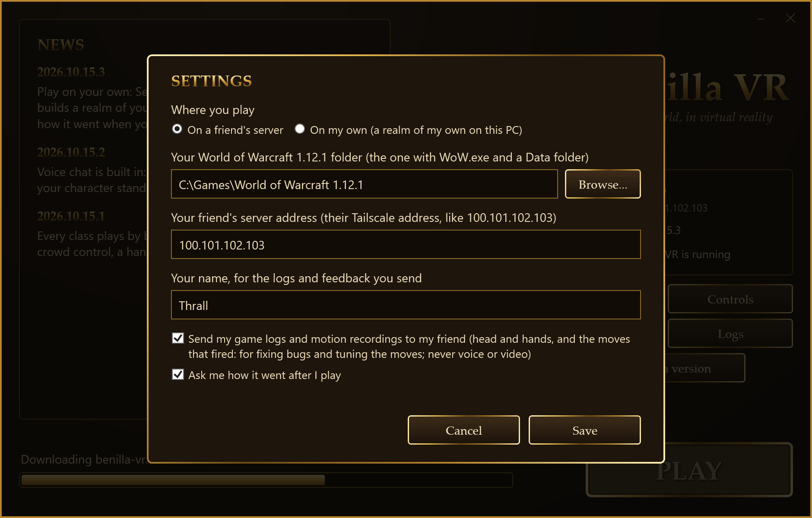
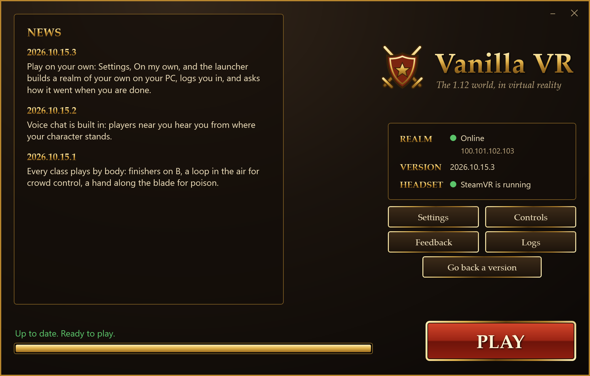
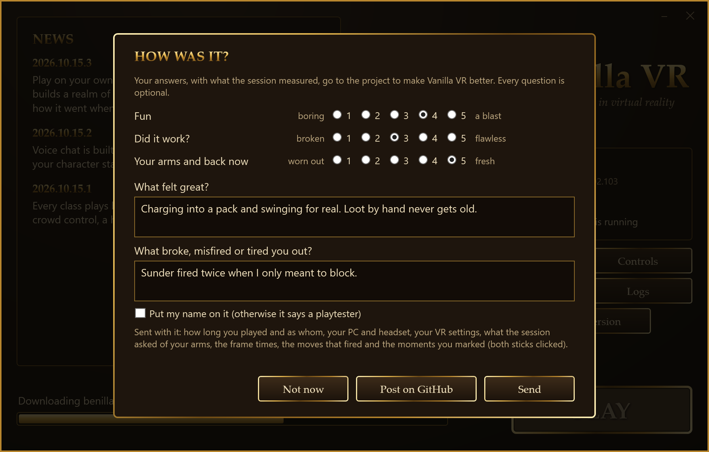

# Install guide

From nothing to standing in the game. There are two ways to play, and you can switch between them
any time:

- **On a friend's server.** Your friend runs the server on their PC, and you join it privately over
  Tailscale. You play together, see each other's arms and hear each other's voices.
- **On your own.** The launcher builds a realm of your own on your PC, the same server and rules your
  friend runs, and logs you straight in. Good for learning the moves, testing a class, or playing
  when your friend is offline.

The first time takes about twenty minutes, plus copying your 1.12.1 client onto your PC if it isn't
there yet. Playing on your own also needs an hour of your PC's time, once, while it builds your
realm. After that it's one double-click.

## 1. What you need

- **Windows 10 or 11** with a graphics card that supports Vulkan (any recent AMD or NVIDIA card).
- **A PC VR headset that works with SteamVR.** A Quest is fine.
- **Your own World of Warcraft 1.12.1 client**: build 5875, English, in a folder of its own (the one
  with `WoW.exe` and a `Data` folder). The kit contains none of the game's files, so everyone brings
  their own.
- **To play on a friend's server**, from the friend who hosts:
  - a Tailscale share link;
  - their Tailscale address (four numbers starting with 100, like `100.101.102.103`);
  - an account and password on their server.
- **To play on your own**: about 6 GB free on the drive you unzip the kit to.

## 2. Get your headset working with SteamVR

1. Install [Steam](https://store.steampowered.com/about/), then **SteamVR** from your Steam library.
2. **A Quest** connects to your PC in any of these ways. Pick one and get to SteamVR's home in the
   headset:
   - **Steam Link** (free, wireless): the Steam Link app from the Quest store.
   - **Air Link or Quest Link** (free): the Meta Quest Link app on your PC; Link uses a USB cable.
   - **Virtual Desktop** (paid, wireless): it starts SteamVR for you.
3. **Other PC VR headsets** work through SteamVR as usual.

## 3. Install Tailscale and accept the share (friend's server only)

Skip this if you only play on your own. Tailscale lets you reach your friend's PC privately, without
anyone opening their router to the internet.

1. Install Tailscale from [tailscale.com/download](https://tailscale.com/download) and sign in when it
   asks: a Google, Microsoft, GitHub or Apple account. A new Tailscale account is right; it makes you
   the owner of your own small network, which accepting a share needs.
2. Open the **share link** your friend sent you and accept it. Their PC then shows up in your
   Tailscale.
3. Check the Tailscale icon by the clock says **Connected**.

You can reach that one PC of theirs and nothing else on their network, and their PC cannot reach
yours. Your friend can take the share back at any time.

## 4. Download the kit

1. Go to [Releases](../../releases/latest) and download the **VanillaVR** zip (about 40 MB).
2. **Unblock it first:** right-click the zip, choose **Properties**, tick **Unblock** at the bottom,
   press **OK**. Without this, Windows may stop the launcher from running.
3. Unzip it into a folder of its own, like `C:\Games\Vanilla VR`. Not inside your World of Warcraft
   folder, and not in Program Files.

## 5. First launch

1. Double-click **`PLAY.cmd`**. If Windows SmartScreen says it protected your PC, choose
   **More info**, then **Run anyway**. The launcher isn't signed.
2. The **Vanilla VR launcher** opens on its Settings:

   

   - **Where you play:** on a friend's server, or on your own.
   - **Your World of Warcraft 1.12.1 folder:** press **Browse...** and pick the folder with `WoW.exe`
     and `Data` in it.
   - **Your friend's server address:** the Tailscale address they gave you. Playing on your own you
     can leave it empty, or give it anyway so your updates and feedback go through them.
   - **Your name:** what your logs and feedback reach your friend under.
   - **Send my game logs:** leave it on so your friend can fix what goes wrong for you and tune the
     moves, or turn it off.
   - **Ask me how it went after I play:** the short question after each session (see step 8).

   Press **Save**.
3. **The launcher puts on your game's own look.** Once it knows your game folder, it reads the login
   screen's art from your install (the logo, the red buttons, the gold frames, the fonts) and wears
   it. Nothing of the game is downloaded or shared: it comes from your own copy. The pictures in
   this guide show the launcher's plain look, before it has a game folder.
4. The launcher checks for updates and fetches any newer version, filling the bar along the bottom,
   and shows the news.

   

5. **HEADSET** shows whether SteamVR is running. Start it now if it isn't (without it the game runs
   flat on your monitor).
6. When it says **Ready to play**, press **PLAY**. The launcher steps aside and the game starts in
   your headset.

## 6. Playing on your own

The first time you press **PLAY** with **On my own** chosen, the launcher offers to build your realm.
It downloads the free [vMaNGOS](https://github.com/vmangos/core) server, its world database and the
[MariaDB](https://mariadb.org) database server (about 130 MB, each checked), then reads your game's
maps from your 1.12.1 folder, which it never changes. The bar shows how far along it is. It takes
about an hour of your PC's time; you can close the launcher and it carries on from where it stopped
next time.

From then on:

- The launcher **wakes your realm** while you read the news (a minute or so), then **PLAY** logs you
  straight in. Make your character and play.
- When you close the game, it **saves your progress and puts your realm to sleep**.
- Your account is a game master's, so these work in the chat box (`.` first):
  - `.levelup 10` gains ten levels, to try a class at the level you want;
  - `.tele ironforge` (or `.lookup tele <name>` to find a place) takes you there;
  - `.partybot add priest` (or `tank`, `healer`, `dps`, or any class) brings a bot into your party.
- Your realm lives in the kit's `solo` folder, and only your PC can reach it.

## 7. In the game

- **Log in** (on a friend's server) with the account and password your friend made for you (the
  password ignores case). Point at a field with your right hand (a laser comes out of your finger),
  pull the trigger, and type on the keyboard that floats below.
- **Every control** is on [the controls sheet](https://claude.ai/artifact/JvCN7hMaJAwirPu6VZmg2J), and
  first-time tips explain each one as it comes up.
- **Something misfired?** Click both thumbsticks together. Both hands buzz, and that moment is marked
  in the session's recording, so it can be found and fixed.
- **Comfort:** tap **Y** for the book, then its **VR** tab. Turning, vignette, seated play,
  vibration and more change at once and are kept for next time.
- **Voice chat:** players near you hear you, and you hear them, from where your characters stand.
  It's set on the same VR tab:
  - **Microphone:** Windows' default, your headset's own, or muted.
  - **Voices:** their volume, or off.
  - **Voice goes:** straight to players, or through the host. Straight to players means the players
    you talk with can see your internet address, as in most games' voice chat. Through the host keeps
    it from them, at a little more delay.

## 8. After you play: how was it?

When you close the game after a real session, the launcher asks how it went:

- **Fun**, **Did it work?** and **Your arms and back now**, each 1 to 5;
- **What felt great?** and **What broke, misfired or tired you out?**

Every question is optional. **Send** sends it to your friend's PC, which posts it on this project's
[issues](../../issues?q=label%3Aplaytest) as a playtest report. **Post on GitHub** opens the same
report as a form for you to post yourself (you need a GitHub account), which is the way when you play
on your own with no friend's address set.

What goes with your answers: how long you played and as which class, your PC's parts and your
headset, your VR settings, what the session asked of your arms, the frame times, the moves that
fired and the moments you marked. Your logs and motion recording go to your friend's PC only, never
to GitHub. Your name is on the report only if you tick **Put my name on it**.

## 9. Updates

There's nothing to do. Each time the launcher opens, it fetches the newest version (only what
changed, every file checked): from your friend's PC, or from this page's releases when you play on
your own. If a new version plays worse, **Go back a version** puts the previous one back, and that
version isn't installed again. Your settings and your realm are never touched.

## If something goes wrong

- **REALM says it can't reach the server.** Is Tailscale connected? Did you accept the share link? Is
  your friend's server running? Then press **Settings** and check the address.
- **Your realm stops building, or won't wake.** The `solo\logs` folder in the kit says why. Press
  **PLAY** again: the build carries on from where it stopped. If your drive is full, free some space
  first (it needs about 6 GB).
- **`PLAY.cmd` flashes and nothing opens.** The zip wasn't unblocked: delete the folder, unblock the
  zip (step 4.2), and unzip it again. Right-clicking `play.ps1` and choosing **Run with PowerShell**
  does the same as the launcher, in a console that shows what went wrong.
- **Windows says `VCRUNTIME140.dll` is missing.** Install the Microsoft Visual C++ Redistributable
  (x64) from Microsoft's website, then try again.
- **The game shows on your monitor, not in the headset.** SteamVR wasn't running when you pressed
  PLAY. Start it, close the game, press PLAY again.
- **Nobody hears you, or you hear nobody.** Check the VR tab's Microphone and Voices. If Windows'
  default microphone isn't your headset's, choose **Headset's**. If one friend's voice never comes
  through, set **Voice goes** to **Through the host**, which works on any home network.
- **Your friend asks for your logs.** The launcher's **Logs** button opens them; they're sent
  automatically unless you turned that off.

## Uninstall

Delete the folder: that removes your realm too. Tailscale uninstalls from Windows' **Settings,
Apps**.
